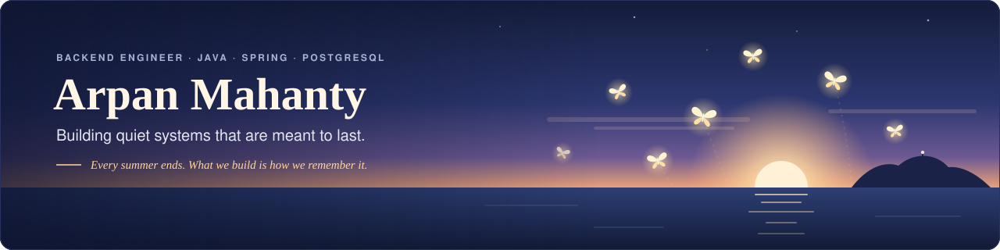
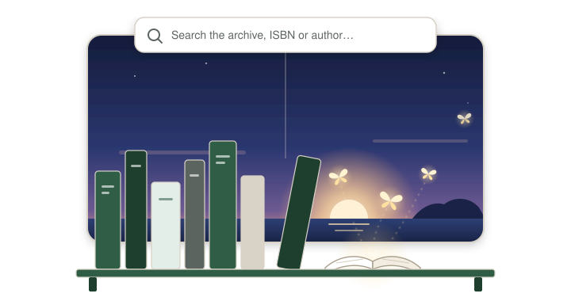
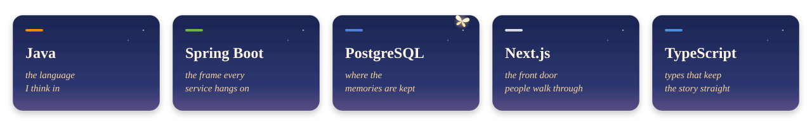
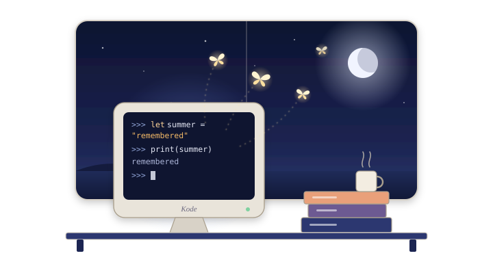
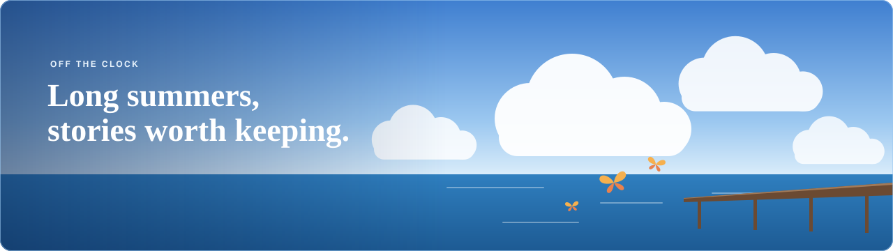

 

Every summer ends. Releases ship, versions get deprecated, teams move on.
What stays is the work done carefully enough to be remembered: systems that are calm under load, code that reads like a good story, and tools people stop noticing because they simply work.

That's the kind of thing I like to build.

 

🎐 &nbsp;<b>AFTER THE SUMMER</b>&nbsp; 🎐

*The cicadas grow quiet, the long light turns gold,* 
*the tide takes our footprints, the evening turns cold.* 
*But the things that we made with our hands and our hearts* 
*keep the summer alive when the next one starts.*

## ☀️ This summer · What I'm building

I'm a backend engineer at **ACCELQ**, working on the services behind a test automation platform in Java, Spring and PostgreSQL.
The same care for calm, long-lived systems runs through **[OpenShelves](https://github.com/openshelves-labs)**, a project I'm building to give university libraries a modern front door: as easy to search as the web, as dependable as the archive behind it.

  

## 🛠️ How I work

- 📖 **Readable first.** Code is read far more often than it is written, so it should read well.
- 🪶 **Small footprint.** The simplest design that holds is usually the one that lasts.
- 🌊 **Calm systems.** Clear boundaries, honest errors, nothing surprising at 3 a.m.
- 🔍 **Know the machinery.** I'd rather understand how something works than wrap it in another library; that's how Kode began.
- 🔐 **Secure by default.** Hash the tokens, lock the doors, assume the database will one day leak.
- 📝 **Write it down.** A design doc and a clear README save more time than any clever trick.
- 🎯 **Finish what matters.** Do the agreed thing, do it properly, then stop. Scope creep is just unfinished work in disguise.

  

## 🌅 Summers past

  

**[Kode](https://github.com/Kode-Devs)**: a programming language interpreter built on the JVM. The project where I first learned how languages work from the inside.

## 🎐 Off the clock

Anime, especially the quiet, bittersweet kind: stories like *Summer Pockets* about one fleeting summer, memories worth keeping, and the people who make them.
They're a big part of why I care about the craft of telling a story well, in fiction and in software.

## 👣 Footprints

<i>The tide takes most footprints. These ones it keeps.</i>

  

  

## 📬 Find me

  

<i>Written on a long summer evening, meant to be remembered.</i>

